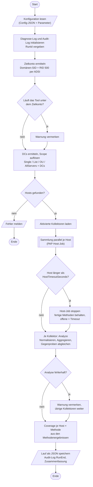
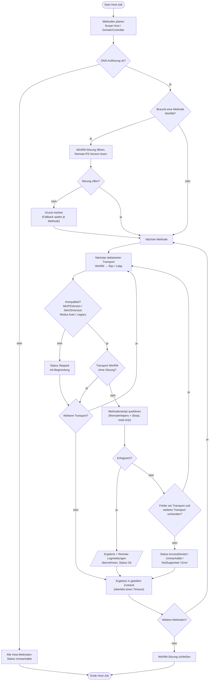
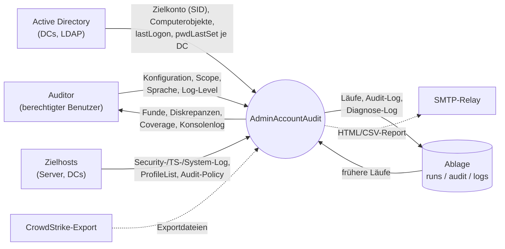
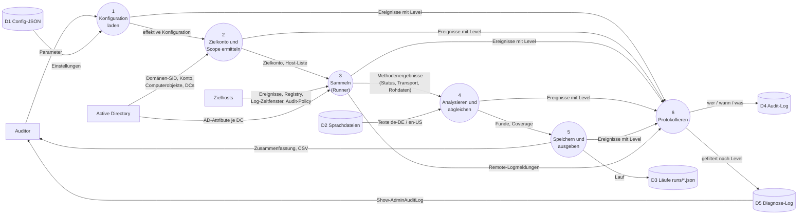

# AdminAccountAudit

Inventarisiert **read-only** alle Abhängigkeiten vom Domänen-Administratorkonto
(Domänen-SID + RID 500): wo, wie und von wo es benutzt wird. Damit lässt sich das
Konto später kontrolliert aus dem Betrieb herauslösen.

Grundsätze: Es wird nichts verändert. Jede Aussage hat nach Möglichkeit eine zweite,
unabhängige Quelle. Jeder Fund trägt seine Herkunft. Nicht erreichbare Quellen
werden als solche gemeldet und nie als „nichts gefunden“ gewertet.

**Stand:** Kern + Kollektor `Logon` (Security-Log, DC-Authentifizierung,
TerminalServices-/Winlogon-Logs, Benutzerprofile, AD-Attribute je DC),
Diagnose-Log mit einstellbarem Detailgrad. GUI, Reporting und die übrigen
Kollektoren folgen.

## Testlauf

Windows PowerShell 5.1, mit einem berechtigten Konto (nicht `Administrator`):

```powershell
# alle Server laut Config + DCs
.\Invoke-AdminAudit.ps1

# nur bestimmte Hosts (DCs werden ergänzt), Ergebnis zusätzlich als CSV, englisch
.\Invoke-AdminAudit.ps1 -ComputerName srv01,srv02 -CsvPath .\funde.csv -Language en-US

# Fehlersuche: alles ins Diagnose-Log, Verbose-Meldungen live auf der Konsole
.\Invoke-AdminAudit.ps1 -ComputerName srv01 -LogLevel Debug -Verbose
```

Mit `-LegacyMode` werden alle Hosts wie Server 2008 / PowerShell 2.0 behandelt
(Abwärtskompatibilitätsmodus). Standard ist die automatische Erkennung je Host.

Konfiguration: `Config\AdminAudit.config.json` (Scope, Timeouts, Parallelität,
Toleranzen, Logging, SMTP). Nicht angegebene Schlüssel nehmen die Defaults aus `Core\Config.ps1`.

## Ablage der Ergebnisse und Logs

| Was | Wo (Standard) | Zweck |
|---|---|---|
| Läufe | `%ProgramData%\AdminAccountAudit\runs\run-*.json` | Funde + Coverage je Lauf, später in der GUI lad- und zusammenführbar |
| Audit-Log | `%ProgramData%\AdminAccountAudit\audit\audit-YYYYMM.jsonl` | Wer hat wann was abgefragt – immer an |
| Diagnose-Log | `%ProgramData%\AdminAccountAudit\logs\diag-YYYYMMDD.log` | Was das Tool intern tut – Detailgrad einstellbar |

## Diagnose-Log

Detailgrad (aufsteigend): `Off` · `Error` · `Warning` · `Info` · `Verbose` · `Debug`.
Datei und Konsole haben je eine eigene Schwelle.

| Level | Inhalt (Beispiele) |
|---|---|
| `Error` | Analyse oder Host-Job unerwartet abgebrochen |
| `Warning` | Methode fehlgeschlagen (Zugriff verweigert, nicht erreichbar), Host-Timeout, DNS-Fehler, Security-Log geleert, Audit-Policy für relevante Kategorien aus, Ergebnis abgeschnitten |
| `Info` | Laufbeginn/-ende mit Kennzahlen, Zielkonto, Scope, WinRM nicht verfügbar → Fallback, übersprungene Methoden (Kompatibilitätsmodus) |
| `Verbose` | Jede Methode mit Transport, Dauer und Trefferzahl; WinRM-Sitzung und Remote-PS-Version; Log-Größe und -Zeitfenster je Host; Profil- und AD-Werte |
| `Debug` | Vollständige XPath-Abfragen, Audit-Policy je Kategorie, effektive Konfiguration, Stacktraces |

Einstellen:

- dauerhaft in der Konfiguration: `Logging.Level`, `Logging.ConsoleLevel`, `Format` (`Text`/`Json`),
  `MaxFileSizeMB` (danach `diag-<Tag>-1.log` …), `RetentionDays`
- pro Lauf: `-LogLevel <Level>` (Datei), `-ConsoleLogLevel <Level>`, oder kurz `-Verbose` / `-Debug`
- später in der GUI: Auswahlfeld in den Einstellungen

Meldungen, die auf den Zielhosts entstehen (z. B. „Audit-Policy aus“), werden mitgesammelt
und mit Host und Methode (`Remote:Logon/SecurityLog`) eingetragen. Werte mit Schlüsseln wie
`Password`, `Credential` oder `Token` werden immer als `***` geschrieben.

Anzeigen und filtern:

```powershell
.\Show-AdminAuditLog.ps1 -Level Warning -Last 50
.\Show-AdminAuditLog.ps1 -RunId 3f2a91c0 -HostName srv01 -Level Debug
.\Show-AdminAuditLog.ps1 -Follow -Level Verbose                 # live mitlesen, Strg+C beendet
.\Show-AdminAuditLog.ps1 -Level Warning -Last 0 -PassThru | Out-GridView
```

## Programmablaufplan (PAP)

Symbole nach DIN 66001: Oval = Start/Ende, Rechteck = Verarbeitung,
Raute = Verzweigung, Parallelogramm = Ein-/Ausgabe, Rechteck mit Doppelrand = Unterprogramm.

### Gesamtlauf (`Invoke-AdminAuditRun`)



### Host-Job und Transport-Fallback (`Invoke-AuditHostJob` / `Invoke-AuditMethod`)



## Datenflussdiagramm (DFD)

Notation: Rechteck = externe Entität, Kreis = Prozess, Zylinder = Datenspeicher,
Pfeil = Datenfluss. Gestrichelt = geplant.

### Ebene 0 – Kontext



### Ebene 1 – Prozesse



## Tests

```powershell
powershell.exe -NoProfile -File .\tests\Test-AdminAudit.ps1
pwsh -NoProfile -File ./tests/Test-AdminAudit.ps1      # geht auch unter Linux
```

Die Tests prüfen alles, was ohne Domäne geht: PS-2.0-Kompatibilität der Remote-Skripte,
vollständige Übersetzungen, Schema, Kontozuordnung, Abgleichslogik, Event-Parser,
die komplette Logon-Analyse mit synthetischen Ereignissen, das Diagnose-Log
(Level, Formate, Maskierung, Rotation, parallele Schreiber) sowie den Runner
(Fallback, Fehlerkapselung, Timeout, Kompatibilitätsmodus).

## Dokumentation

- [README.html](README.html) – diese Seite als eigenständige HTML-Datei, Diagramme als eingebettete Grafik
  (offline lesbar, kein Skript nötig). Nach Änderungen an der README neu erzeugen:
  `python3 tools/build_readme_html.py` (braucht pandoc und Mermaid-CLI)
- [docs/Design.md](docs/Design.md) – Architektur, Datenmodell, Kollektor-Vertrag, Abgleichsregeln
- [docs/Rechte-und-Voraussetzungen.md](docs/Rechte-und-Voraussetzungen.md) – Rechte, Ports, Verhalten bei Fehlern
- [Collectors/_Template.Collector.ps1](Collectors/_Template.Collector.ps1) – Vorlage für neue Kollektoren
